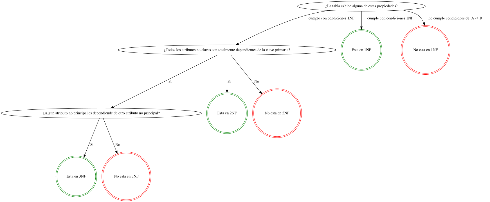
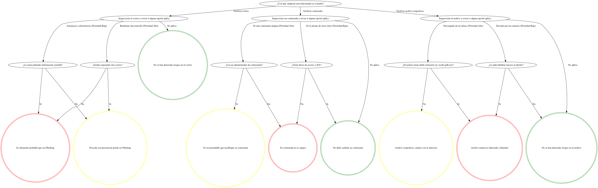

# Pruebas del motor de navegación — grafos de ejemplo

Pruebas del recorrido guiado del grafo con corto-circuito por reglas
(`MotorNavegacion`), ejercitadas sobre dos **grafos de ejemplo no clínicos**:

- **Normalización de base de datos** (1NF, 2NF, 3NF).
- **Triaje de ciberseguridad** (correo, contraseñas, archivos sospechosos).

Los `.dot`/`.txt` fuente están en `grafos_ejemplo/` y su equivalente JSON
implementado (el que cargan las pruebas) en
`backend/src/main/resources/static/`:

| Ejemplo | Grafo | Reglas |
|---------|-------|--------|
| Normalización | `ejemplo_grafo_norm.json` | `ejemplo_reglas_norm.json` |
| Ciberseguridad | `ejemplo_grafo_sec.json` | `ejemplo_reglas_sec.json` |

Son JUnit 5 **puro** (sin Spring ni base de datos): cargan el grafo y la base de
reglas con `GrafoClinicoParser` / `BaseReglasParser` usando `ClassPathResource`,
y ejercitan el motor paso a paso.

## Cómo ejecutarlas

Desde `signbb-backend/backend` (estas pruebas no necesitan PostgreSQL/Redis):

    ./mvnw -Dtest='MotorNavegacion*Test' test

---

## Ejemplo 1 — Normalización de base de datos

> La imagen se genera desde `grafos_ejemplo/grafo_norm.dot`. Ese `.dot`
> conserva aristas demostrativas (`en_1nf`/`en_2nf`) que el JSON de prueba no
> incluye.

### Estructura (`ejemplo_grafo_norm.json`)

| Nodo | Rol | Interacción | Peso |
|------|-----|-------------|------|
| `inicio` | arranque | — | 1 |
| `q_1nf` | ¿La tabla exhibe las propiedades de 1NF? | SELECCION_MULTIPLE | 1 |
| `q_2nf` | ¿Dependencia total de la clave primaria? | SI_NO | 2 |
| `q_3nf` | ¿Dependencia transitiva entre atributos no principales? | SI_NO | 3 |
| `en_3nf` | La tabla está en 3NF | recomendacion | 1 |
| `no_1nf` | No está en 1NF | consulta_medica | 3 |
| `no_2nf` | No está en 2NF | consulta_medica | 2 |
| `no_3nf` | No está en 3NF | consulta_medica | 1 |

Aristas: `inicio -inicia_navegacion-> q_1nf`;
`q_1nf -{CELDA_UNICA, CLAVE_PRIMARIA, SIN_FILAS_O_COLUMNAS_DUPLICADAS, VALOR_UNICO_POR_PAR}-> q_2nf`;
`q_1nf -NINGUNA-> no_1nf`; `q_2nf -SI-> q_3nf`; `q_2nf -NO-> no_2nf`;
`q_3nf -SI-> no_3nf`; `q_3nf -NO-> en_3nf`.

### Reglas (`ejemplo_reglas_norm.json`)

- **R1** — `and` de las cuatro propiedades de `q_1nf` → `q_2nf` (`CONSULTAR_MEDICO`):
  regla "gate" que solo permite avanzar a la segunda pregunta cuando se marcan
  todas las propiedades.
- **R2** — `q_1nf = NINGUNA` → `no_1nf` (`URGENCIA`, el rojo de mayor peso).
- **R3** — `q_2nf = NO` → `no_2nf` (`URGENCIA`).
- **R4** — `q_3nf = SI` → `no_3nf` (`URGENCIA`).

`grafo_norm_reglas.txt` describe el mismo AND de propiedades (R1) y una regla
resumen `1NF & 2NF & 3NF` (R2 en el `.txt`).

### Pruebas — `MotorNavegacionNormalizacionTest`

Rojo de mayor peso (`no_1nf`); selección múltiple con la regla AND gate R1 que
continúa a `q_2nf`; selección múltiple parcial que no dispara R1 y conserva
todas las respuestas; y preguntas de selección única hasta `no_2nf` / `no_3nf`.

---

## Ejemplo 2 — Triaje de ciberseguridad

### Estructura (`ejemplo_grafo_sec.json`)

| Nodo | Rol | Interacción | Peso |
|------|-----|-------------|------|
| `O` | Categoría de la consulta (raíz) | SELECCION_UNICA | 2 |
| `E1` | Inspeccionar el correo | SELECCION_MULTIPLE | 2 |
| `E2` | ¿Esperaba el correo? | SI_NO | 3 |
| `E3` | ¿Piden información sensible? | SI_NO | 1 |
| `P1` | Inspeccionar la contraseña | SELECCION_MULTIPLE | 2 |
| `P2` | ¿Usa administrador de contraseñas? | SI_NO | 3 |
| `P3` | ¿Tiene llaves de acceso o 2FA? | SI_NO | 1 |
| `A1` | Inspeccionar el archivo | SELECCION_MULTIPLE | 2 |
| `A2` | ¿Doble extensión? | SI_NO | 3 |
| `A3` | ¿Pide habilitar macros? | SI_NO | 1 |
| `ET1/PT1/AT1` | Riesgo alto (rojo) | consulta_medica | 3 |
| `ET2/PT2/AT2` | Precaución (amarillo) | recomendacion | 2 |
| `ET3/PT3/AT3` | Sin riesgo (verde) | recomendacion | 1 |

Las opciones de `E1`/`P1`/`A1` que el `.dot` marca *"Prioridad Alta/Baja"* se
codifican en el **peso del nodo destino** (Alta = 3, Baja = 1). Aristas por
categoría:

- Correo: `O -Verificar correo-> E1`; `E1 -{Remitente desconocido, Amenazas o advertencias, No aplica}-> {E2, E3, ET3}`; `E2 -{No, Si}-> {ET1, ET2}`; `E3 -{Si, No}-> {ET1, ET2}`.
- Contraseñas: `O -Verificar contraseña-> P1`; `P1 -{Es una contraseña antigua, Es la misma de otros sitios, No aplica}-> {P2, P3, PT3}`; `P2 -{No, Si}-> {PT1, PT2}`; `P3 -{No, Si}-> {PT1, PT3}`.
- Archivos: `O -Verificar archivo sospechoso-> A1`; `A1 -{Descargado de un enlace, Enviado por un contacto, No aplica}-> {A2, A3, AT3}`; `A2 -{Si, No}-> {AT1, AT2}`; `A3 -{Si, No}-> {AT1, AT3}`.

### Reglas (`ejemplo_reglas_sec.json`, todas `URGENCIA`)

- **R1** — `O=Verificar correo`, `E1=Remitente desconocido`, `E2=No` → `ET1`.
- **R2** — `O=Verificar correo`, `E1=Amenazas o advertencias`, `E3=Si` → `ET1`.
- **R3** — `O=Verificar contraseña`, `P1=Es una contraseña antigua`, `P2=No` → `PT1`.
- **R4** — `O=Verificar archivo sospechoso`, `A1=Descargado de un enlace`, `A2=Si` → `AT1`.
- **R5** — `and[ O=Verificar archivo sospechoso, or[A1=Descargado de un enlace, A1=Enviado por un contacto], or[A2=Si, A3=Si] ]` → `AT1`
  (regla con **AND y OR anidados**).

### Pruebas — `MotorNavegacionSeguridadTest`

Varias opciones resueltas por la pregunta de mayor prioridad (incluso marcando
primero la de menor prioridad); empate de peso resuelto de forma estable;
regla que acumula respuestas de distintas preguntas (R1) e interrumpe en `ET1`;
regla AND/OR (R5) y regla AND simple (R4) hacia `AT1`; y caminos sin riesgo
(`ET3`, `PT3`) que cierran en `NORMAL`.

---

## Convenciones del motor que asumen las pruebas

- `iniciar(estado, grafo)` auto-avanza por una única arista `inicia_navegacion`
  hasta la primera pregunta real.
- Tras cada respuesta se evalúan las reglas: si la ganadora apunta a un
  **terminal**, el recorrido corta; si apunta a una **pregunta**, es una regla
  "gate" y continúa (su nivel no se reporta como alerta).
- Las reglas ya disparadas no se reevalúan.
- En selección múltiple se registran **todas** las opciones marcadas (para que
  las reglas AND/OR las vean) y, si ninguna regla dispara, se avanza por la de
  mayor peso; a igual peso gana la primera marcada (desempate estable).
