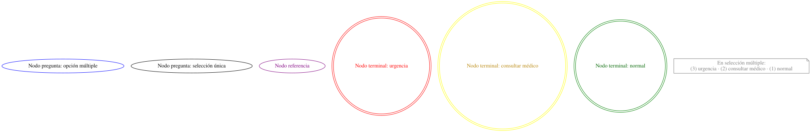
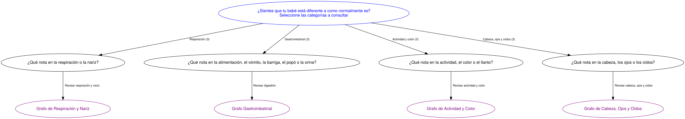
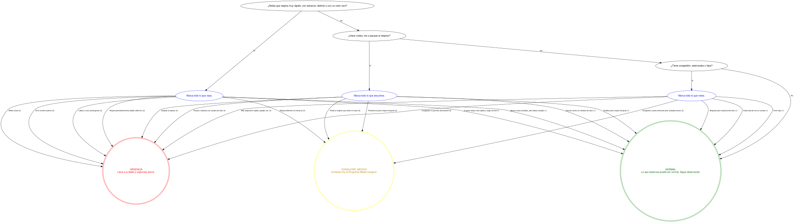
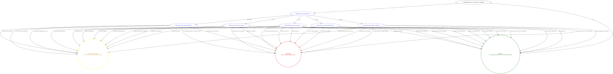
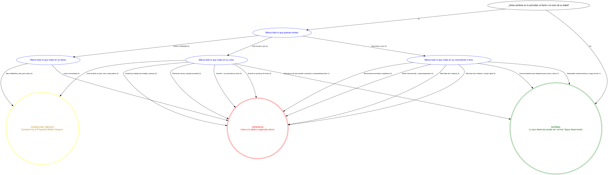
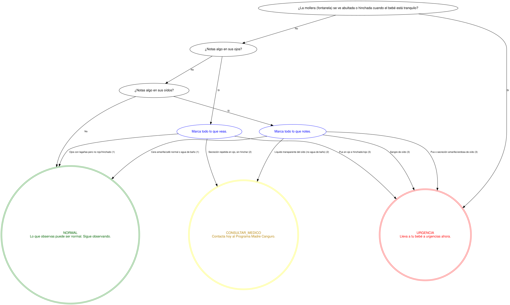

# Entorno de pruebas y demo {#entorno_pruebas}

Este documento describe el entorno de datos que se siembra para las pruebas
punto a punto y las demostraciones con expertos.

El entorno está formado por:

- Un supervisor, creado por `InicializadorSeguridad` si no existe.
- Un médico de ejemplo, autor de los cuatro subgrafos y de sus bases de reglas.
- Un padre de ejemplo.
- El grafo raíz con cuatro categorías.
- Los cuatro subgrafos publicados y sus bases de reglas.

El seed está **apagado por defecto**. Se enciende con
`SIGNBB_SEED_DEMO_ACTIVA=true` y no se puede usar con
`signbb.entorno=produccion`.

## Usuarios creados

| Usuario | Rol | Correo | Contraseña | Institución |
|---|---|---|---|---|
| Supervisor | `MEDICO_SUPERVISOR` | `supervisor@signbb.local` | `Supervisor123` | — |
| Médico ejemplo | `MEDICO` | `medico.ejemplo@signbb.local` | `Medico123` | Fundación Canguro |
| Padre ejemplo | `PADRE` | `padre.ejemplo@signbb.local` | `Padre123` | — |

El supervisor lo crea `InicializadorSeguridad` si no hay ninguno; el seed no lo
duplica. Las contraseñas son de desarrollo: cámbialas fuera de la máquina local
y no actives el seed en producción.

## Cómo se ejecuta el seed

### Backend local

```bash
cd signbb-backend/backend
SIGNBB_SIEMBRA_ACTIVA=true SIGNBB_SEED_DEMO_ACTIVA=true ./mvnw spring-boot:run
```

### Docker

```bash
cd signbb-backend/contenedores
SIGNBB_SEED_DEMO_ACTIVA=true docker compose up -d --build
```

El runner corre después de la seguridad y de `DatabaseInit`:

1. Crea el médico y el padre si no existen.
2. Crea los borradores de los cuatro subgrafos y de sus reglas.
3. Publica cada subgrafo con `ServicioAutoria.publicar`.
4. Deja al médico como autor, agrega las referencias al grafo raíz y registra
   una versión por subgrafo.

Es idempotente: si una cuenta o un `grafoId` ya existen, se omiten. Para volver
a sembrar desde cero hay que borrar PostgreSQL y Redis:

```bash
cd signbb-backend/contenedores
docker compose down -v
```

## Grafos

La fuente de autoría está en `grafo_sistema/` (raíz del workspace). Las copias
de esta carpeta de documentación están en `grafos/` y `datos/`.

### Índice de nodos



- Nodo pregunta de selección múltiple: azul.
- Nodo pregunta de selección única: negro.
- Nodo referencia: púrpura.
- Terminal urgencia: doble círculo rojo.
- Terminal consultar médico: doble círculo amarillo.
- Terminal normal: doble círculo verde.

En las preguntas de selección múltiple, cada opción muestra su peso entre
paréntesis: `(3)` urgencia, `(2)` consultar médico, `(1)` normal.

### Grafo raíz

El orquestador principal. La pregunta inicial permite elegir una o varias
categorías; cada categoría pasa por un puente de selección única y termina en
una referencia al subgrafo.



- DOT: `grafos/raiz.dot`
- SVG: `grafos/raiz.svg`
- Regenerar:

  ```bash
  cd docs/entorno-pruebas
  dot -Tsvg grafos/raiz.dot -o grafos/raiz.svg
  ```

### Respiración y nariz

Subgrafo con preguntas de entrada Sí/No y listas de selección múltiple para
lo que se ve, lo que se oye y la nariz. No usa la opción “ninguno de los
anteriores”: la ausencia de signos se resuelve con el “No” del filtro.



- DOT: `grafos/respiracion.dot`
- SVG: `grafos/respiracion.svg`
- Regenerar:

  ```bash
  dot -Tsvg grafos/respiracion.dot -o grafos/respiracion.svg
  ```

### Gastrointestinal

Subgrafo de alimentación, vómito, barriga, popó y orina. La entrada habilita
una selección múltiple de subáreas; cada subárea tiene su propia lista de
signos.



- DOT: `grafos/gastrointestinal.dot`
- SVG: `grafos/gastrointestinal.svg`
- Regenerar:

  ```bash
  dot -Tsvg grafos/gastrointestinal.dot -o grafos/gastrointestinal.svg
  ```

### Actividad y color

Subgrafo de movimiento/tono, llanto e ictericia. La cianosis no forma parte de
este subgrafo: los signos azulados están en Respiración.



- DOT: `grafos/actividad_color.dot`
- SVG: `grafos/actividad_color.svg`
- Regenerar:

  ```bash
  dot -Tsvg grafos/actividad_color.dot -o grafos/actividad_color.svg
  ```

### Cabeza, ojos y oídos

Subgrafo de fontanela, ojos y oídos. El signo compuesto “Pus en ojo e
hinchado/rojo” se conserva como una sola opción y lleva a urgencia.



- DOT: `grafos/cabeza.dot`
- SVG: `grafos/cabeza.svg`
- Regenerar:

  ```bash
  dot -Tsvg grafos/cabeza.dot -o grafos/cabeza.svg
  ```

## Bases de reglas

Cada subgrafo tiene una base con **dos reglas**: una de `URGENCIA` y otra de
`CONSULTAR_MEDICO`. No se declaran reglas `NORMAL` porque el motor las rechaza;
el nivel normal se resuelve por las aristas y el cierre implícito.

| Grafo | Regla de urgencia | Regla de consulta | Tabla completa |
|---|---|---|---|
| Respiración | `R_RESP_URG` | `R_RESP_CON` | [reglas_respiracion.md](reglas/reglas_respiracion.md) |
| Gastrointestinal | `R_GASTRO_URG` | `R_GASTRO_CON` | [reglas_gastro.md](reglas/reglas_gastro.md) |
| Actividad/Color | `R_NEURO_URG` | `R_NEURO_CON` | [reglas_activo_color.md](reglas/reglas_activo_color.md) |
| Cabeza/Ojos/Oídos | `R_CAB_URG` | `R_CAB_CON` | [reglas_cabeza.md](reglas/reglas_cabeza.md) |

Las tablas completas muestran la FND, el nodo destino y el nivel de cada regla.
La versión consolidada está en
[`reglas/base_reglas.md`](reglas/base_reglas.md).

## Scripts de ayuda

Los scripts están en `scripts/` y trabajan sobre `datos/` y `grafos/`.

### `json_a_dot.py`

Convierte los grafos JSON en DOT y, con `--render`, en SVG. Sirve para
comprobar que el JSON y los grafos dibujados a mano coinciden. Si una arista
trae `peso`, lo agrega al label como `(3)`, `(2)` o `(1)`.

```bash
cd docs/entorno-pruebas
python3 scripts/json_a_dot.py datos/grafo_*.json -o generado --render
```

Salida: `generado/grafo_*.dot` y `generado/grafo_*.svg`.

### `reglas_a_markdown.py`

Convierte una base de reglas JSON en una tabla Markdown.

```bash
python3 scripts/reglas_a_markdown.py datos/reglas_gastro.json \
  -o reglas/reglas_gastro.md
```

Para generar todas las tablas:

```bash
for archivo in datos/reglas_*.json; do
  nombre="$(basename "$archivo" .json)"
  python3 scripts/reglas_a_markdown.py "$archivo" -o "reglas/${nombre}.md"
done
python3 scripts/reglas_a_markdown.py datos/base_reglas.json -o reglas/base_reglas.md
```

### `regenerar_grafos.sh`

Hace todo lo anterior de una vez:

- Regenera los SVG de los `.dot`.
- Valida los JSON.
- Genera los DOT/SVG desde los JSON.
- Genera las tablas Markdown de reglas.

```bash
cd docs/entorno-pruebas
./scripts/regenerar_grafos.sh
```

Requisitos: `graphviz` (`dot`) y `python3`.

## Validación del entorno

### Pruebas automáticas

Backend:

```bash
cd signbb-backend/backend
./mvnw test
./mvnw -Dtest=MotorNavegacionTest test
./mvnw verify
```

Frontend:

```bash
cd signbb-frontend
npx ng test --watch=false
```

### Comprobaciones del seed

Con PostgreSQL arriba, después de arrancar con el seed activo:

```sql
select correo, nombre, rol, institucion, activo
from usuario
order by rol;

select count(*) from grafo_clinico_entity;       -- 5: raíz + 4 subgrafos
select count(*) from base_reglas_entity;         -- 4
select count(*) from borrador_subgrafo_entity;   -- 4
select count(*) from version_contenido;          -- 4
```

El médico debe ver sus cuatro subgrafos en la app de autoría y el padre debe
poder iniciar una consulta en la app de consulta.

## Notas

- El seed no crea el supervisor; lo hace `InicializadorSeguridad`.
- El seed no crea el grafo raíz; lo hace `DatabaseInit` con
  `backend/src/main/resources/static/grafo_sistema/grafo_raiz.json`.
- Los JSON del seed runtime están en
  `backend/src/main/resources/seed/demo/`. Las copias de `datos/` son para esta
  documentación y para los scripts.
- Si cambias los grafos en `grafo_sistema/`, copia los DOT/SVG/JSON a
  `docs/entorno-pruebas/` y ejecuta `scripts/regenerar_grafos.sh`.
