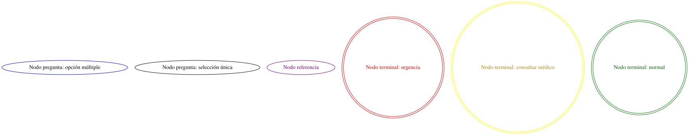
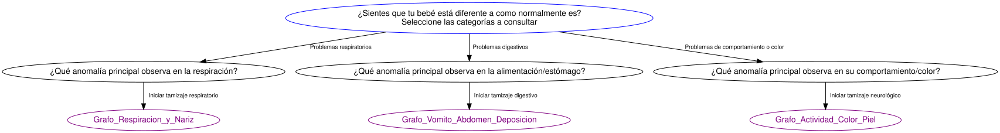
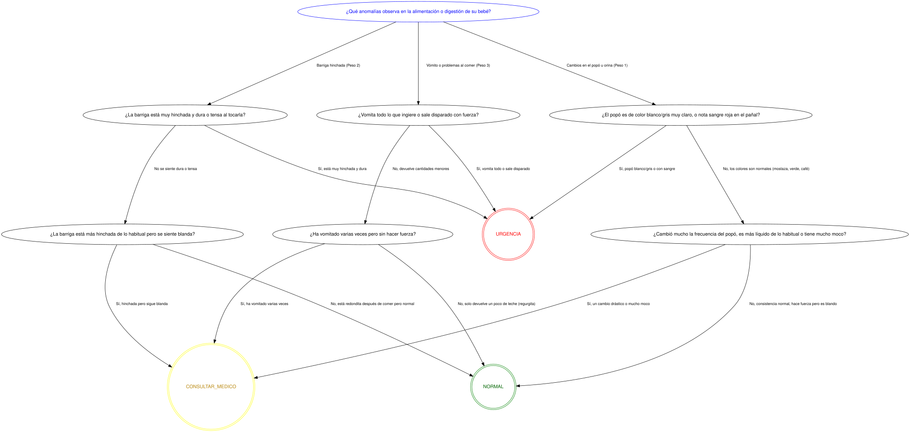
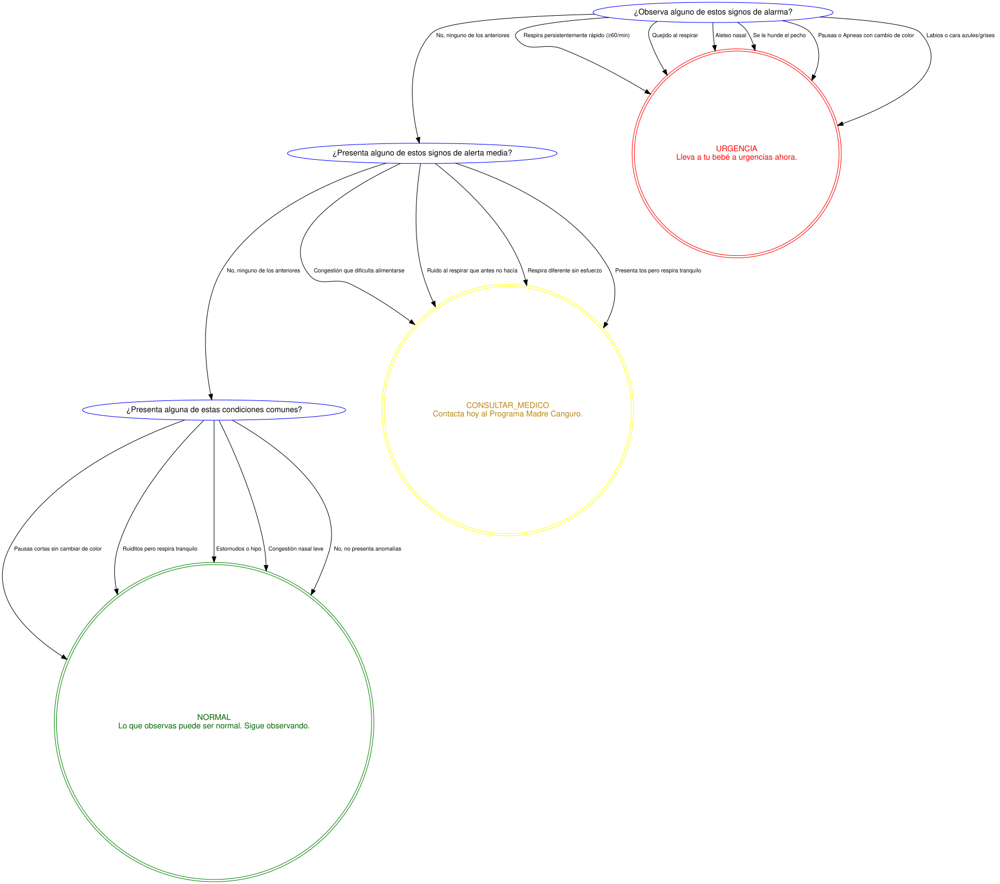
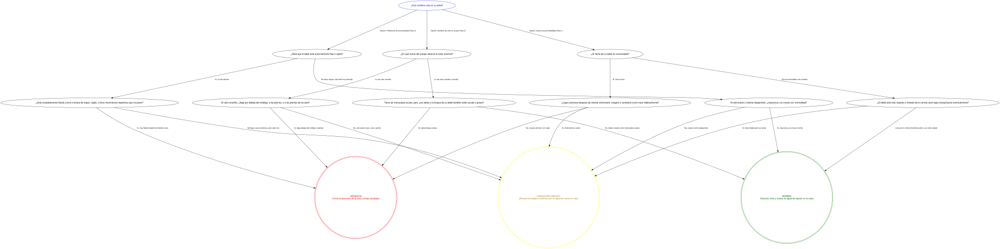

# Grafo sistema

El grafo del sistema se construyó utilizando una base de reglas creada mediante la consulta de síntomas y la validación realizada por la Doctora Catalina Lince.

## Indice

Leyenda de los tipos de nodo usados en todos los grafos (color y forma):



- **Nodo pregunta (selección múltiple):** azul.
- **Nodo pregunta (selección única):** negro.
- **Nodo referencia (subgrafo):** púrpura.
- **Nodo terminal urgencia:** doble círculo rojo.
- **Nodo terminal consultar médico:** doble círculo amarillo.
- **Nodo terminal normal:** doble círculo verde.

## Grafo Raíz

Es el orquestador principal. Parte de una pregunta de selección múltiple que permite elegir una o varias categorías; cada categoría pasa por un nodo puente de selección única y termina en un nodo de referencia que abre el subgrafo correspondiente.

Se definieron tres categorías para los grafos:

1. Gastrointestinal: preguntas de alimentación, cambios en las heces y cambios en el abdomen del bebé.
2. Respiración: preguntas relacionadas con esta función corporal.
3. Activo y color: preguntas sobre cambios comportamentales y de tono en la piel.

Además, la raíz ofrece **Piel** y **Temperatura** como categorías todavía sin subgrafos, para que los médicos publiquen los suyos desde autoría. Mientras no tengan ninguno, sus preguntas puente se podan al componer y la cuidadora no las ve.



## Grafo Gastrointestinal

Subgrafo de alimentación, abdomen y deposiciones. Se recorre con una cola de prioridad: cada rama (vómito, abdomen, popó) tiene un peso y puede terminar en urgencia (corta la ejecución), consulta médica (continúa con la siguiente rama en cola) o normal.



## Grafo Respiración

Subgrafo secuencial de respiración y nariz. Primero descarta los signos de alarma (urgencia); si no hay ninguno, evalúa los signos de alerta media (consulta médica) y, en último caso, las condiciones comunes (normal).



## Grafo Activo y color

Subgrafo de tono/actividad, coloración de la piel y llanto. Se recorre con una cola de prioridad por peso: tono (peso 3), color (peso 2) y llanto (peso 1), cada rama con desenlaces de urgencia, consulta médica o normal.



## Herramientas

### Construir grafos visualmente

Se usa el formato de texto DOT y se exporta a SVG para visualizar con facilidad.

```bash
dot -Tsvg raiz.dot -o raiz.svg
```

### Representacion visual de base de reglas

Toma un formato JSON de reglas (`base_reglas.json`) y lo representa como una tabla Markdown en `generado/base_reglas.md`.

```bash
python3 reglas_a_markdown.py base_reglas.json
```

### Representacion visual de grafo

Toma un formato JSON de grafo (`grafo_*.json`), lo pasa a formato DOT y finalmente lo renderiza como SVG en `generado/`.

```bash
python3 json_a_dot.py --render
```

> El script `json_a_dot.py` usa el `id` de cada nodo del JSON tal cual como `id` DOT, de modo que los desajustes entre el JSON y los `.dot` dibujados a mano quedan visibles.
